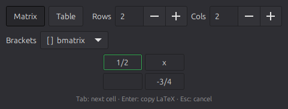
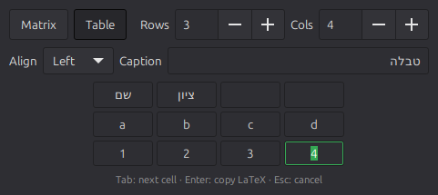

<<<<<<< HEAD
# latex-grid

A tiny popup for Linux (GTK 3) that turns a grid you type into LaTeX and copies it to the clipboard.
Press a shortcut, fill the cells, press **Enter**, paste into your document.

 

## What it produces

**Matrix** (bare environment, ready to drop inside `$…$`, `\[…\]` or `align`):

```latex
\begin{pmatrix}
\frac{1}{2} & x \\
0 & -\frac{3}{4}
\end{pmatrix}
```

- Brackets: `pmatrix ( )`, `bmatrix [ ]`, `vmatrix | |`, `Bmatrix { }`, or plain `matrix`.
- `a/b` becomes `\frac{a}{b}`, `-a/b` becomes `-\frac{a}{b}`.
- Empty cells become `0`.

**Table** (full grid, a line around every cell):

```latex
\begin{table}[h]
\centering
\begin{tabular}{|l|l|}
\hline
Name & Score \\ \hline
a & 1 \\ \hline
\end{tabular}
\caption{Results}
\end{table}
```

- Column alignment: left, centre or right. The caption is optional and is left out when empty.
- Cells are copied as typed, so `$x^2$` and right-to-left text such as Hebrew work.
  A bare `&` is escaped to `\&`.

Needs `amsmath` for matrices.

## Keys

| Key | Action |
|---|---|
| Tab / Shift+Tab | Next / previous cell (wraps row by row) |
| ↑ / ↓ | Cell above / below |
| Enter | Copy the LaTeX and close |
| Esc | Close without copying |

Paste tab-separated text (for example cells copied from a spreadsheet) into any cell and it
spreads over the grid from there, growing the grid if needed.

## Install

Requires Python 3 and GTK 3 bindings (`python3-gi`), which come preinstalled on Linux Mint,
Ubuntu and most GTK desktops.

```bash
git clone https://github.com/YardenMiz/latex-grid.git
ln -s "$PWD/latex-grid/latex-grid" ~/.local/bin/latex-grid
```

Then bind shortcuts to the commands (Cinnamon: *System Settings → Keyboard → Shortcuts →
Custom Shortcuts*):

| Shortcut | Command |
|---|---|
| Super+M | `latex-grid --matrix` |
| Super+T | `latex-grid --table` |

On X11 the clipboard belongs to the program that copied, so after Enter the window hides and
the process waits in the background until something else takes over the clipboard (a clipboard
manager such as CopyQ does this at once) or for at most an hour.

## Tests

```bash
python3 -m unittest
```

## Credits

The matrix behaviour (`pmatrix`/`bmatrix`, `a/b` → `\frac`) is inspired by
[jasonwarta/latex-matrix](https://github.com/jasonwarta/latex-matrix). No code was copied
from it. The table output follows the full-grid style of
[tablesgenerator.com](https://www.tablesgenerator.com/).
=======
# Matrix-And-Table-Latex-Generator
A Repo for handy matrix and table generation in Latex
>>>>>>> de258e42daa89c177c047e157d5b3d0e0199eedf
